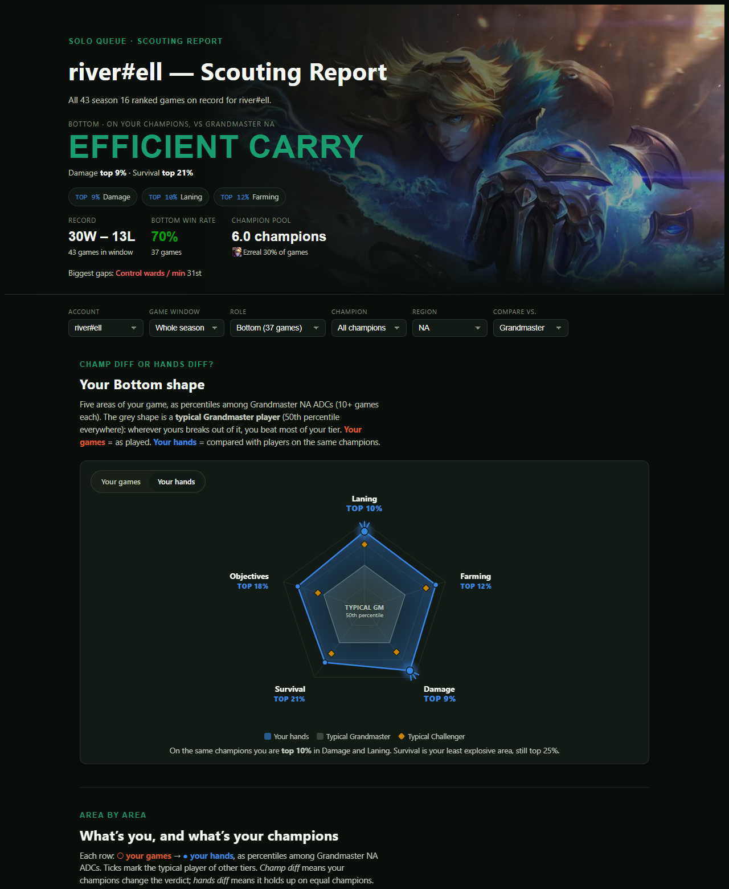

# hands-diff

**Champ diff or hands diff? What your stats say about *you*, once your champions are accounted for.**

**[→ Live scouting report](https://astinlin01.github.io/hands-diff/)** · a static page built by this pipeline

hands-diff pulls ~26k season-16 high-elo solo queue games (~263k player-games, Diamond → Challenger, NA + KR) from the Riot API and draws your **performance shape**: five areas of your game ranked against the tier you play in, shown two ways, as played and on equal champions. Where the two disagree, your champions are doing the work (*champ diff*). Where they agree, it's you (*hands diff*).

[](https://astinlin01.github.io/hands-diff/)

## What it shows

- **Your shape.** Laning, Farming, Damage, Survival and Objectives as percentiles among players of your tier (10+ games each). The grey shape is a typical player of that tier. Wherever yours breaks out of it, you beat most of your tier, and top-10% spikes glow.
- **Your games vs your hands.** *Your games* = your stats as played, champions included. *Your hands* = compared with players on the same champions. Each area gets a verdict: **hands diff** when it holds up on equal champions, **champ diff** when your champions move you between strength, middle and weakness, with the champion responsible named ("Kai'Sa adds a little on top").
- **What your damage costs you.** Damage across, Survival up: *efficient carry*, *glass cannon*, *safe, low impact* or *struggling*, next to every player in your tier and the typical player of the other tiers.
- **Also:** champion pool vs your tier, every headline stat as a percentile (raw and "on your champions, in an even game"), your biggest gaps, nearest pro (LCK/LPL), and your games.

**Compare against the tier you actually play in.** Matchmaking pairs you with players of your MMR, so the fair ruler is that tier, which can differ from your displayed rank (e.g. Master rank, GM lobbies). Set it per account with `COMPARE_TIERS`. The page can switch to any tier, and higher tiers show up as targets.

## How it works

Raw match stats mostly measure *which champion you played* and *how the game went*. A stomp inflates damage, gold, CS and objectives all at once. Each area is built to remove what isn't yours:

1. **Teammates' lead and game length come out of both views.** Per role, every stat is regressed on your four teammates' kill/gold lead over the four enemies outside your lane, plus a spline of game length, and read at a typical, even, median-length game. Your *own* lead stays in: these are performance areas, and being ahead is the point.
2. **The champion comes out of "your hands" too.** Champion fixed effects, with rare champions (under 30 games in the role) pooled into their Data Dragon class. Early-game stats (≤14:00) are adjusted for champion only, since the end-of-game context comes after them.
3. **The matchup is not adjusted for, on purpose.** Enemy laners change single games (they explain up to 8% more of CS diff @10), but over a profile they wash out because you don't pick your opponents: profiles with and without the matchup adjustment correlate at **0.96–1.00**.
4. **Averages vs averages, as percentiles.** Your average over the selected games is ranked against other players' averages (10+ games), season-matched, never against single games.

| Area | Built from |
|---|---|
| Laning | CS diff @10, gold and XP diff @14, max CS lead, turret plates |
| Farming | CS/min, gold/min, share of team gold, lane minions by 10:00 |
| Damage | damage/min, share of team damage, damage per gold |
| Survival | deaths per minute and before 14:00 (fewer = higher) |
| Objectives | building and objective damage, turret participation |

## Does it hold up?

`hands-diff diagnostics` measures both views on the season's reference players (calculations covered by hand-checked tests):

| Five areas, season 16 (median over roles) | Your games | Your hands |
|---|---:|---:|
| Champion's share of the area's variance | 5–13% | **≈0%** |
| Correlation with winning (absolute) | 0.11–0.27 | 0.11–0.27 |
| Split-half reliability of player averages | 0.55–0.68 | 0.39–0.56 |

- **The hands view removes the champion completely,** and leaves the link to winning alone. Your own lead is kept on purpose.
- **Shapes are real.** With each player's overall level taken out, their shape from odd games matches their shape from even games at a median r of **0.71–0.78** (games) and **0.58–0.66** (hands), against ~0 for random pairs (players with 20+ games).
- **It's not one "good at the game" number.** The biggest common factor explains 49–57% of the differences between players. Five independent areas would be 20%, and a single factor would be 100%.
- **Damage costs deaths.** Survival is the most independent area and runs against Damage (−0.21 to −0.51 across roles, −0.37 for bot). That trade-off is the risk-for-damage chart.

### How we got here

Version 1 clustered games with k-means and found *how the game went* (cluster win rates of ~15% / ~60% / ~90%). Version 2 removed that with the adjustments above and measured 15 hand-built playstyle traits with archetype labels. A full review on the complete timeline data showed those 15 traits measured about 7 things, and the ones that were both stable and unrelated to winning (vision, ability usage, crowd control) said little about how an ADC plays. Most of what people call style in solo queue turned out to be champion choice or output. So this version measures output directly, and separates the part that comes from your champions.

## Run it yourself

```
python -m venv venv
venv\Scripts\activate            # source venv/bin/activate on macOS/Linux
pip install -r requirements.txt
pip install -e .                 # installs the hands-diff command
copy .env.example .env           # cp on macOS/Linux; then fill it in
```

- `RIOT_API_KEY`: a development key from the [Riot developer portal](https://developer.riotgames.com). These expire every 24h.
- `RIOT_IDS`: your accounts as `gameName#tagLine`, comma-separated.
- `PUBLISH_RIOT_IDS`: the accounts shown on the published page. The export never falls back to `RIOT_IDS`, so an account is published only if you list it.
- `COMPARE_TIERS`: each account's default comparison tier, e.g. `yourname#na1:GRANDMASTER`.

Then, from the repo root:

```
hands-diff refresh               # your new games -> features -> timelines -> export -> docs/index.html
hands-diff                       # every command; each takes --help
```

Building the reference population from scratch (player pools, match IDs, match data, timelines) takes a while on a dev key's rate limit. Every command, data file and the full run order are in **[DEVELOPING.md](DEVELOPING.md)**.

## Testing

```
pytest
```

The suite encodes the analysis conventions against real games whose expected values were checked by hand: CS including jungle camps, per-minute normalization, season tagging, remake exclusion, the outcome and champion adjustments, timeline features across all five roles, the areas and both views, the diagnostics, an end-to-end export, and the page's JavaScript math run through Node against the Python originals. Fixture games are real match payloads with every player identity replaced by a salted hash (`hands_diff.tools.anonymize_fixtures`, enforced by a test).

## Limitations

- **Tier is a snapshot.** Reference players are tagged with their rank on the day their pool was fetched, not at game time.
- **Percentiles squeeze at the top.** Far above your comparison tier, every area sits at 90+ and the shape says less. Compare against a higher tier.
- **Champion pool is its own question.** The hands view takes your champions out on purpose. What you choose to play is shown separately, in the champion pool section.
- **Kill participation isn't an area.** It tracked Damage at up to 0.86 and was the least reliable candidate (0.42–0.63 at 20 games), so it's shown only as a stat.

---

## License and credits

Code: [MIT](LICENSE). Match data via the [Riot Games API](https://developer.riotgames.com); pro match data from [Oracle's Elixir](https://oracleselixir.com).

hands-diff isn't endorsed by Riot Games and doesn't reflect the views or opinions of Riot Games or anyone officially involved in producing or managing Riot Games properties. Riot Games, and all associated properties are trademarks or registered trademarks of Riot Games, Inc.
